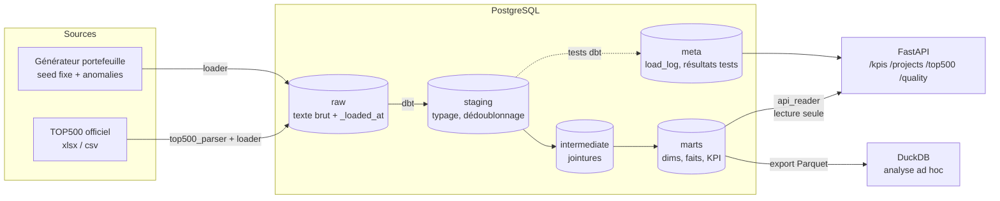

# HPC Portfolio Data Hub

Mini **Enterprise Data Hub** pour piloter un portefeuille de projets de supercalculateurs
et situer le constructeur sur son marché grâce au **TOP500**.
Stack : **PostgreSQL · dbt · DuckDB · FastAPI · Docker**, tests et CI inclus.

> Projet de démonstration réalisé pour un entretien Data Engineer (Bull Enterprise Data Hub).
> Les données de portefeuille sont **synthétiques** (clients fictifs) ; les données TOP500 sont
> les listes officielles de [top500.org](https://top500.org).

---

## Lancer en 3 commandes

```bash
git clone <url-du-depot> hpc-portfolio-data-hub && cd hpc-portfolio-data-hub
cp ~/Téléchargements/TOP500_2026*.xlsx data/raw/top500/   # facultatif, voir « Données »
make demo
```

`make demo` crée `.env` (mots de passe aléatoires), construit les images, lance
`postgres → pipeline → api` et affiche les KPI principaux. Ensuite :

| Quoi | Où |
|---|---|
| API + documentation Swagger | http://localhost:8001/docs |
| Documentation dbt (lignage, tests) | `make dbt-docs` → http://localhost:8080 |
| Analyse ad hoc DuckDB | `make analytics` |
| Toutes les commandes | `make help` |

Prérequis : Docker (Compose v2), Python 3.11+ pour les commandes locales, `make`.

---

## Architecture



| Couche | Rôle | Outil |
|---|---|---|
| Ingestion | Chargement **idempotent** dans `raw`, journal `meta.load_log` | Python (`pipeline/ingest`) |
| Transformation | `staging` → `intermediate` → `marts`, 75 tests | dbt sur PostgreSQL |
| Qualité | Résultats des tests dbt historisés dans `meta.dbt_test_results` | `pipeline/quality.py` |
| Exposition | API REST en lecture seule, rôle `api_reader` | FastAPI |
| Analytique | Marts en Parquet + base DuckDB | `pipeline/export_duckdb.py` |
| Orchestration | Enchaînement des étapes | `pipeline/run.py` (service Compose `pipeline`) |

Détails et choix de modélisation : [docs/architecture.md](docs/architecture.md).

---

## Données

### TOP500 (réelles)

Listes officielles, publiées en juin et novembre. Téléchargement gratuit après inscription
sur top500.org (lien *Sign up* en pied de page), format Excel, à déposer dans
`data/raw/top500/` sous le nom **`TOP500_AAAAMM.xlsx`** (l'édition est lue dans le nom).
Éditions conseillées : 2024-11, 2025-06, 2025-11, 2026-06. Sans fichier, la partie TOP500
est simplement vide : le reste du hub fonctionne.

Le parsing (`pipeline/ingest/top500_parser.py`) absorbe les variations de format entre
éditions — documentées et testées :

| Variation | Traitement |
|---|---|
| Noms de colonnes (`Total Cores`/`Cores`, `Manufacturer`/`Vendor`…) | table d'alias vers un schéma canonique |
| Unités Rmax/Rpeak (`GFlop/s`, `TFlop/s`, `PFlop/s`) | conversion en TFlop/s |
| Ligne de titre au-dessus des en-têtes | détection de la ligne « Rank » |
| Séparateurs de milliers, `;` ou `,` | nettoyage numérique, détection du séparateur |
| `Interconnect Family` (Gigabit Ethernet) ≠ `Interconnect` (Slingshot-11) | deux colonnes conservées |
| Puissance non déclarée (~60 % des systèmes) | `has_power_data`, efficacité calculée sur le sous-ensemble |
| Constructeurs Bull / Atos / Eviden, libellés composés (« HPE, GALAXY ») | seed `vendor_mapping` + premier constructeur nommé |

### Portefeuille HPC (synthétique)

Les données réelles d'un portefeuille de supercalculateurs sont confidentielles :
`pipeline/generate_portfolio.py` les simule (seed 42, date de référence 31/10/2026) avec des
distributions réalistes, et **des anomalies injectées en quantité connue**, listées dans
`data/raw/portfolio/anomalies.json` :

| Anomalie injectée | Nb | Détectée par | Traitement |
|---|---|---|---|
| Projets en double (double export) | 3 | `source_projects_unique_project_id` | dédoublonnés en staging |
| Livraison antérieure au démarrage | 2 | `assert_delivery_after_start` | exclus des KPI de délai |
| Coûts négatifs (avoirs mal saisis) | 4 | `assert_costs_positive` | exclus des cumuls |
| Incidents sur un projet inexistant | 5 | `incidents_project_exists` | exclus de `fct_incidents` |
| Incidents clos avant ouverture | 2 | `incidents_closed_after_opened` | exclus de `fct_incidents` |
| Sévérité hors référentiel (« urgent ») | 1 | `incidents_severity_in_referential` | exclus de `fct_incidents` |

Les 6 tests sont en `severity: warn` : ils **signalent** sans bloquer le pipeline, et
`GET /quality/report` montre exactement ces 6 alertes. Les autres tests (unicité, intégrité
référentielle, plages de valeurs) sont bloquants.

---

## KPI

Calculés dans `marts.mart_portfolio_kpis` (global, par segment, par pays) et
`marts.mart_top500_vendor_share` (par édition et constructeur).

| KPI | Définition |
|---|---|
| Taux de livraison à l'heure | projets livrés avec `livraison réelle ≤ prévue`, dates cohérentes uniquement |
| Retard moyen | moyenne de `max(livraison réelle − prévue, 0)` sur les projets livrés |
| Projets en retard sur planning | en cours, date de livraison prévue dépassée |
| Dépassement budgétaire | (coûts − budget) / budget, par projet et cumulé ; « en dépassement » au-delà de +5 % |
| Incidents | ouverts, délai moyen de résolution, par sévérité |
| Parts de marché TOP500 | en nombre de systèmes et en Rmax, évolution en points entre éditions |
| Efficacité énergétique | Rmax / puissance (GFlops/W), sur les systèmes qui déclarent leur puissance |

Valeurs de référence (seed 42) : 60 projets, 54,8 % livrés à l'heure, 18,6 jours de retard
moyen, −1,13 % d'écart budgétaire global mais 13 projets au-delà de +5 %, 13 incidents
ouverts. Un test dbt (`assert_portfolio_kpis_match_reference`) vérifie ces valeurs,
recalculées indépendamment en pandas : il a d'ailleurs révélé un piège PostgreSQL
(`greatest(NULL, 0)` vaut 0 et faussait le retard moyen).

**TOP500 juin 2026** : Bull compte 58 systèmes (11,6 % de la liste) et 10,7 % de la
puissance totale — 3ᵉ en Rmax derrière HPE (42,8 %) et le seul système LineShine, et 2ᵉ des
constructeurs multi-systèmes ; son efficacité agrégée (~27 GFlops/W) est environ le double
de celle de Dell ou Lenovo.

---

## API

Lecture seule, documentée automatiquement (Swagger `/docs`, ReDoc `/redoc`).

| Endpoint | Contenu |
|---|---|
| `GET /kpis/portfolio` | KPI global, par segment, par pays, incidents par sévérité |
| `GET /projects?status=&segment=&page=&page_size=` | liste paginée des projets |
| `GET /projects/{id}` | détail, jalons, incidents (`404` si inconnu, `422` si format invalide) |
| `GET /top500/vendors?edition=&order_by=rmax\|systems` | parts de marché (dernière édition par défaut) |
| `GET /quality/report` | résultats du dernier `dbt build` |
| `GET /health` | état de l'API et de la base |

Validation Pydantic des paramètres, pagination bornée (`page_size ≤ 100`), `503` si la base
ou les marts sont indisponibles. Le SQL est isolé dans `api/repository.py` (paramètres liés,
tri sur liste blanche).

---

## PostgreSQL et DuckDB : pourquoi les deux

| | PostgreSQL | DuckDB |
|---|---|---|
| Rôle | système de référence | analyse ad hoc |
| Forces | transactions, droits par rôle, accès concurrent, API | colonnaire, sans serveur, très rapide sur agrégats |
| Ici | `raw` → `marts`, tests dbt, API | exports Parquet des marts + `hub.duckdb` |

`make analytics` exécute `analytics/queries.sql` : pivot des parts de marché par édition,
systèmes les plus efficaces, premier mois de dépassement budgétaire, délai médian de
résolution par segment et sévérité. Les Parquet sont aussi lisibles par pandas, Spark ou
Power BI, sans toucher à la base de production.

---

## Choix techniques

- **Idempotence** : chaque chargement remplace sa table (portefeuille) ou sa partition
  (une édition TOP500) dans une transaction ; relancer le pipeline donne le même état.
- **Raw en texte, typage dans dbt** : une valeur mal formée est détectée par un test au lieu
  d'être perdue au chargement.
- **Anomalies signalées, pas supprimées** : `staging` ne filtre rien (sauf les doublons
  exacts) ; le filtrage est explicite dans les marts et chaque exclusion a son test.
- **Moindre privilège** : l'API utilise `api_reader` (SELECT sur `marts` et `meta`,
  transactions en lecture seule) ; aucun secret dans le code (`.env`, `.env.example`).
- **Seed de correspondance des constructeurs** plutôt que du SQL : auditable, modifiable
  sans déploiement ; un constructeur inconnu déclenche une alerte.
- **Pas d'orchestrateur** : un script séquentiel suffit à cette échelle (voir évolutions).

## Tests et CI

| | Contenu |
|---|---|
| `pytest` | 72 tests : parsing TOP500, générateur, chargeur (intégration PostgreSQL si `PG_TEST_DSN`), qualité, API |
| `dbt build` | 75 tests de données : unicité, intégrité, plages, cohérence métier, KPI de référence |
| CI GitHub Actions | ruff, pytest avec PostgreSQL de service, pipeline complet + `dbt build` sur base éphémère, build des images Docker |

## Limites

- Données portefeuille synthétiques ; les distributions sont plausibles, pas calibrées.
- Rechargement complet à chaque exécution (volumes faibles) ; pas de modèles incrémentaux.
- Pas d'historisation des dimensions (SCD) ni de suivi des changements de statut.
- Une connexion par requête dans l'API (suffisant en interne ; pool à prévoir en charge).
- Pas d'authentification sur l'API.

## Pistes d'évolution

- **Orchestration** : Airflow ou Dagster (un DAG par source, rejeux, alertes, SLA).
- **Catalogue et lignage** : OpenMetadata ou DataHub alimentés par les artefacts dbt.
- **RBAC** : rôles par population (finance, opérations), row-level security par client,
  authentification OAuth2 sur l'API.
- **Incrémental et historisation** : modèles dbt incrémentaux, snapshots (SCD2) des projets.
- **Observabilité** : alerting sur les tests en échec et la fraîcheur des sources
  (`dbt source freshness`), métriques de chargement depuis `meta.load_log`.

## Dépannage

| Symptôme | Cause et solution |
|---|---|
| `port is already allocated` | port pris par un autre projet : changer `API_PORT` / `POSTGRES_HOST_PORT` dans `.env` |
| `meta.dbt_test_results does not exist` | `init.sql` en échec au premier démarrage (ex. `API_DB_PASSWORD` absent) : compléter `.env` puis `make reset && make up` |
| `ModuleNotFoundError: pipeline` | lancer `pytest` depuis la racine après `pip install -e ".[dev]"` |
| psql affiche `(END)` | pager : touche `q`, ou `psql -P pager=off` |

## Structure

```
api/                 FastAPI : routeurs, schémas Pydantic, repository SQL, Dockerfile
pipeline/            ingestion, générateur, qualité, export DuckDB, orchestration, Dockerfile
dbt/                 modèles staging / intermediate / marts, seeds, tests, macros
infra/postgres/      init.sql : schémas, journal, rôle api_reader
analytics/           requêtes DuckDB de démonstration
data/raw/            portfolio/ (versionné) et top500/ (à télécharger)
tests/               pytest
docs/                architecture et script de démo
```
