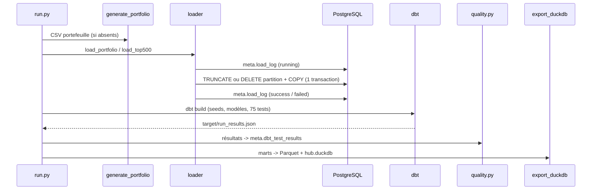
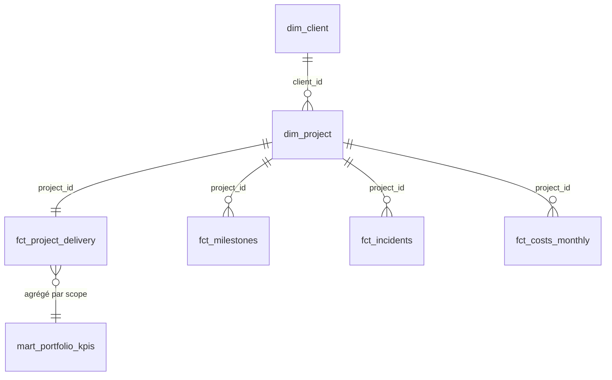

# Architecture et choix de conception

## Flux

## Schémas PostgreSQL

| Schéma | Contenu | Matérialisation | Accès API |
|---|---|---|---|
| `raw` | copie des sources, tout en texte (portefeuille) ou typé simple (TOP500), `_loaded_at`, `_source_file` | tables (Python) | non |
| `staging` | typage, renommage, dédoublonnage, seed `vendor_mapping` | vues | non |
| `intermediate` | agrégats par projet (jalons, coûts), incidents enrichis | vues | non |
| `marts` | dimensions, faits, KPI | tables | oui (SELECT) |
| `meta` | `load_log`, `dbt_test_results`, `v_latest_test_results` | tables / vue | oui (SELECT) |

`generate_schema_name` est surchargé pour que dbt écrive dans ces schémas exacts (et non
`public_marts`), ce qui permet de leur attacher les droits dans `init.sql`.

## Modèle des marts

- `fct_project_delivery` : grain projet ; délai, écart budgétaire, incidents. Les KPI de
  délai ne prennent que les projets livrés aux dates cohérentes (`has_valid_dates`).
- `mart_portfolio_kpis` : grain (scope, valeur) avec `scope ∈ {global, segment, country}` :
  une seule table sert le global et les ventilations, sans requêtes multiples côté API.
- `mart_top500_vendor_share` : grain (édition, constructeur), construit sur une grille
  éditions × constructeurs pour qu'un constructeur absent d'une édition compte 0 et que
  l'évolution (`lag`) soit juste.

## Idempotence du chargement

| Source | Stratégie | Pourquoi |
|---|---|---|
| Portefeuille | `TRUNCATE` + `COPY` | un fichier = la table entière |
| TOP500 | `DELETE WHERE edition = …` + `COPY` | un fichier = une édition ; les autres restent intactes |

Suppression et insertion sont dans la même transaction : un échec laisse la table dans son
état précédent, et `meta.load_log` garde la trace de l'échec. Une colonne nouvelle dans la
source est ajoutée (`ALTER TABLE ADD COLUMN IF NOT EXISTS`) ; aucune n'est supprimée.

## Stratégie qualité

| Niveau | Exemples | Sévérité |
|---|---|---|
| Source | unicité de `raw.projects.project_id` | warn |
| Staging | intégrité référentielle, référentiels de valeurs, cohérence de dates | warn pour les anomalies connues, error sinon |
| Marts | unicité des clés, plages (0-100 %), parts TOP500 = 100 %, 500 systèmes par édition | error |
| Non-régression | KPI globaux = valeurs recalculées en pandas | warn |

Tous les résultats sont historisés dans `meta.dbt_test_results` (un run = un
`invocation_id`) : l'API expose le dernier run, et l'historique permet de suivre la qualité
dans le temps.

## Sécurité

- Secrets uniquement dans `.env` (non versionné) ; `make env` génère des mots de passe.
- `api_reader` : `LOGIN`, `default_transaction_read_only = on`, `USAGE` sur `marts` et
  `meta`, `SELECT` + droits par défaut sur les futures tables de `marts` (dbt les recrée).
- API : paramètres SQL liés, tri sur liste blanche, identifiants validés par regex.
- Conteneurs : API en utilisateur non root ; pipeline avec l'UID de l'hôte.
